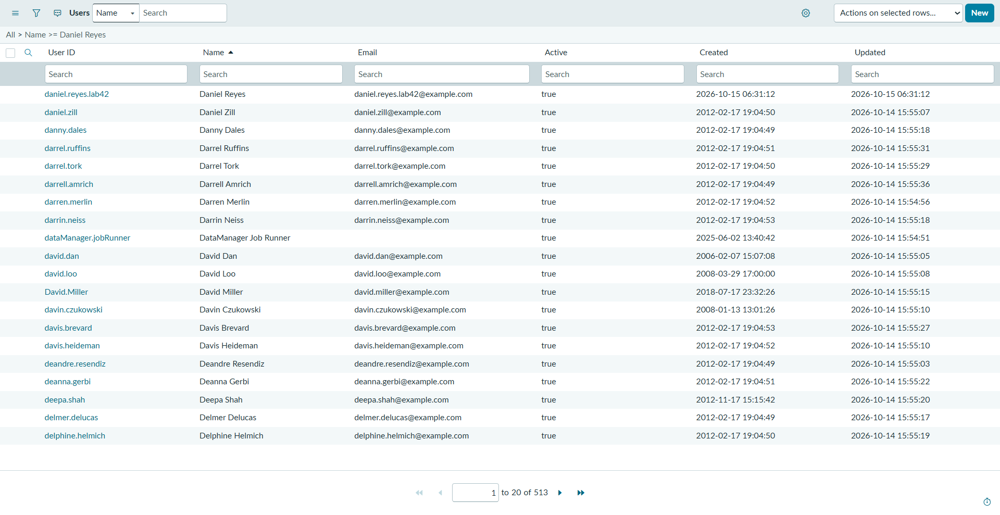
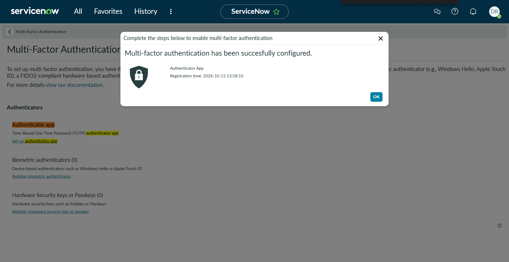
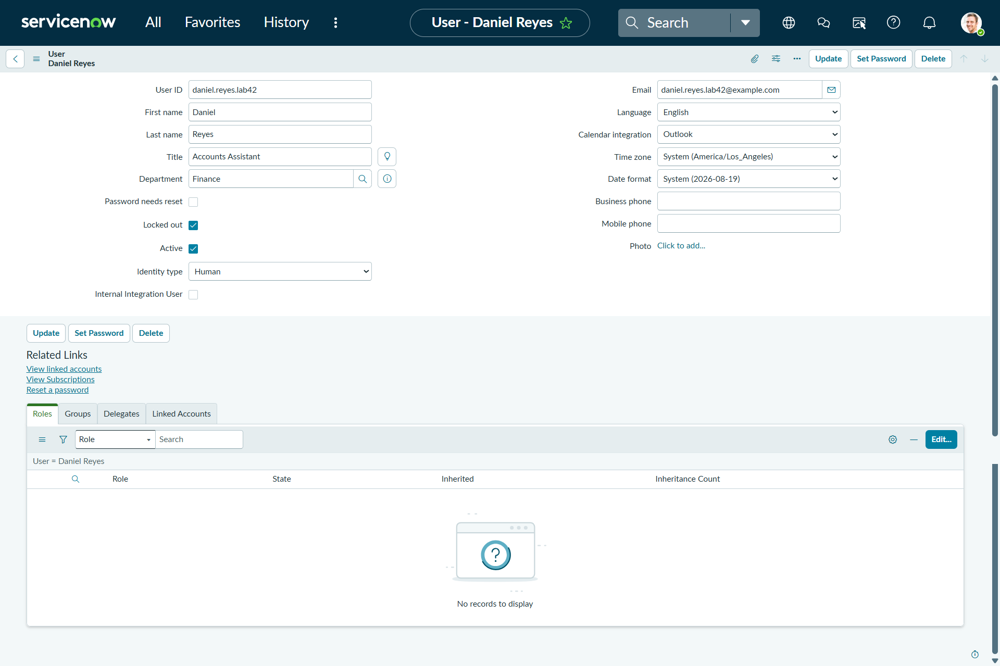
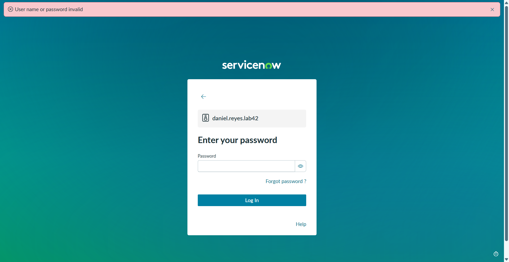
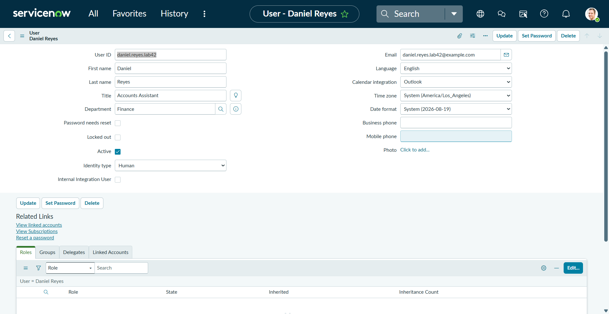
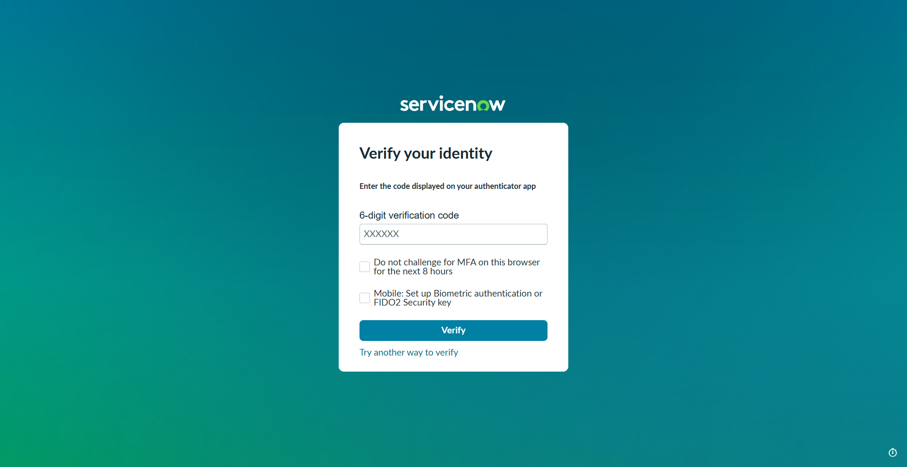
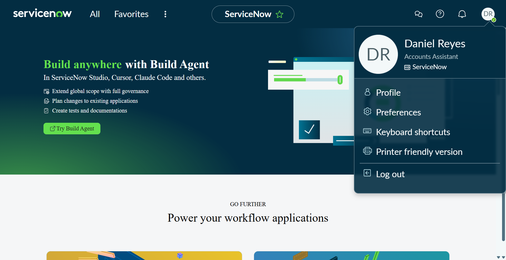
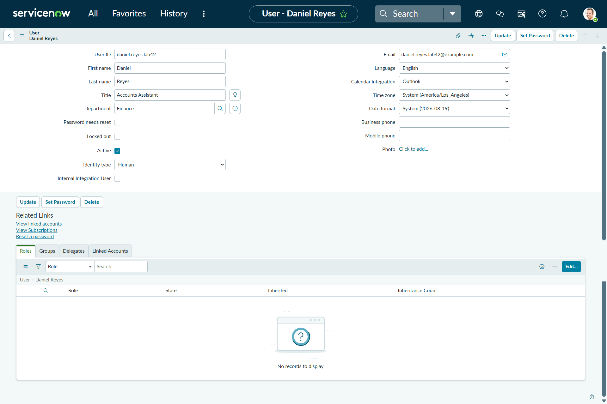
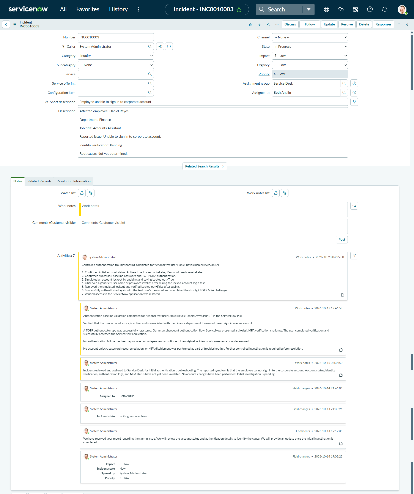
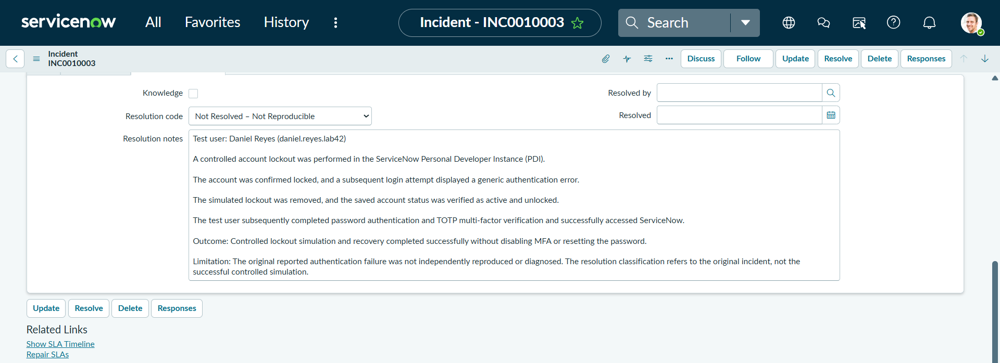

# ServiceNow IAM Lab 4.2
## Controlled Account Lockout, MFA Recovery & Incident Documentation

**Platform:** ServiceNow Personal Developer Instance (PDI)  
**Focus:** Identity and Access Management (IAM), Authentication Troubleshooting, Multi-Factor Authentication (MFA), Incident Management  
**Environment:** Personal training lab with fictional test identities

---

## Project Overview

This hands-on IAM project demonstrates a controlled account lockout and recovery scenario using ServiceNow.

The lab follows an incident investigation workflow, from verifying the user's initial authentication status to reproducing a simulated login failure, performing account unlock remediation, validating access restoration, and documenting the results.

**Important scope distinction:** The controlled simulation was completed successfully. The root cause of the original reported incident was not independently established, and the original incident remained In Progress.

## Objectives

- Verify user identity and account configuration.
- Establish successful password and MFA authentication.
- Simulate and observe a controlled account lockout.
- Restore account access without disabling MFA.
- Validate successful authentication after remediation.
- Document troubleshooting activities and investigation limitations.

## Lab Environment

| Component | Details |
|---|---|
| Platform | ServiceNow PDI |
| Test identity | Daniel Reyes |
| User ID | `daniel.reyes.lab42` |
| Department | Finance |
| Job title | Accounts Assistant |
| Authentication | Password + TOTP |
| Incident | `INC0010003` |
| Scope | Controlled training simulation |

---

## 1. Test User Provisioning

Created and verified a fictional Finance employee account for the authentication troubleshooting scenario.

**Evidence:** ServiceNow test identity created for controlled IAM troubleshooting.

## 2. MFA Registration

Registered a Time-Based One-Time Password (TOTP) authenticator for the test account.

**Evidence:** Successful authenticator registration for the test identity.

## 3. Controlled Account Lockout

Established a working authentication baseline, then deliberately enabled the Locked out setting in the isolated training account.

**Evidence:** Test account placed into a locked state before remediation.

## 4. Authentication Failure Observation

Attempted to authenticate while the test account was locked.

The application displayed a generic authentication error.

**Evidence:** Authentication failure observed during the controlled test.

**Security note:** A generic error message alone does not establish the underlying failure cause.

## 5. Account Unlock Remediation

Removed the simulated account lockout and verified the unlocked account state.

**Evidence:** Controlled account unlock performed and verified.

## 6. Post-Remediation MFA Verification

Retested authentication after removing the lockout.

The user was presented with a six-digit TOTP verification challenge.

**Evidence:** MFA challenge presented during post-remediation authentication.

## 7. Successful Authentication Recovery

Completed password and TOTP verification successfully and accessed the ServiceNow application.

**Evidence:** Successful application access following controlled remediation.

## 8. Final Account Status Verification

Rechecked the test user record to validate the recovered state.

**Evidence:** Test account verified as active and unlocked after the simulation.

## 9. ServiceNow Incident Work Notes

Recorded the investigation workflow and verified observations in the incident's internal Work Notes.

**Evidence:** Technical troubleshooting activities documented in the ServiceNow incident history.

## 10. Resolution Documentation

Recorded the controlled simulation outcome and clearly distinguished it from the original reported incident.

**Evidence:** Resolution information and investigation limitations documented.

**Recorded resolution code:** Not Resolved - Not Reproducible.

**Final incident state:** In Progress.

The recorded classification concerns the original reported issue and must not be interpreted as proof that the original incident was permanently fixed.

---

## Troubleshooting Workflow

| Stage | Action | Result |
|---|---|---|
| Baseline | Validated account and authentication | Successful |
| Simulation | Enabled controlled account lockout | Completed |
| Failure observation | Attempted locked-account authentication | Generic error observed |
| Remediation | Removed the simulated lockout | Completed |
| Verification | Retested password and TOTP | Successful |
| Functional test | Accessed ServiceNow | Successful |
| Documentation | Recorded Work Notes and resolution information | Saved |

## IAM and ITSM Skills Demonstrated

- Identity and user account administration
- Account lockout investigation
- Authentication troubleshooting
- Multi-Factor Authentication (MFA)
- TOTP authentication verification
- Controlled account recovery
- Incident Management
- IT Service Management (ITSM)
- Technical Work Notes and audit documentation
- Before-and-after security validation
- Evidence-based troubleshooting
- Root cause assessment and reporting limitations

## Key Lessons Learned

1. Verify the account's initial state before performing remediation.
2. Establish a working authentication baseline.
3. Confirm the observed failure rather than guessing its cause.
4. Apply controlled remediation only to the intended identity.
5. Verify recovery through a functional authentication test.
6. Preserve MFA when it is not necessary to disable it.
7. Record accurate investigation notes and limitations.
8. Distinguish a completed simulation from a resolved original incident.

## Project Outcome

**Controlled account lockout and recovery simulation: COMPLETED**

Successfully demonstrated account status validation, simulated authentication failure, account unlock remediation, post-remediation MFA verification, successful application access, and incident documentation.

The original reported authentication issue was not independently diagnosed or confirmed as resolved.

---

*Independent hands-on IAM training project conducted in a ServiceNow Personal Developer Instance using a fictional test identity.*
